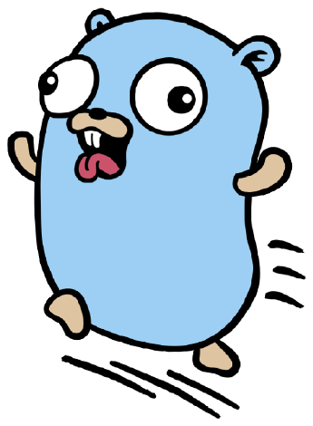

  

  

  
  
  
  
  

##  Sobre mim

&nbsp; Desenvolvedor Fullstack: Go no backend, Vue/Quasar e React no frontend, Flutter no mobile. 
&nbsp; Também trabalho com Node.js e Ruby. 
&nbsp; Dados com PostgreSQL e Redis; deploy com Docker e Nginx. 
&nbsp; Projetos open source com IA rodando localmente. 
&nbsp; Arch Linux + Hyprland no dia a dia. 
&nbsp; Participando do Hacktoberfest 2026 no DEV. 
&nbsp; Brasil

 

##  Ferramentas

<table>
  <tr>
    <td width="150"><b>Sistema & Desktop</b></td>
    <td>
      
      
      
      
      
      
      
    </td>
  </tr>
  <tr>
    <td width="150"><b>Dev</b></td>
    <td>
      
      <picture><source media="(prefers-color-scheme: dark)" srcset="https://cdn.simpleicons.org/github/white"></picture>
      
      
      
      
      
      
    </td>
  </tr>
  <tr>
    <td width="150"><b>Segurança</b></td>
    <td>
      
      
    </td>
  </tr>
  <tr>
    <td width="150"><b>IA</b></td>
    <td>
      <picture><source media="(prefers-color-scheme: dark)" srcset="https://cdn.simpleicons.org/ollama/white"></picture>
       
      Ollama com Gemma local
    </td>
  </tr>
</table>

##  Stack

<table>
  <tr>
    <td width="150"><b>Linguagens</b></td>
    <td>
      
      
      
      
      
      
      
      
      <picture><source media="(prefers-color-scheme: dark)" srcset="https://api.iconify.design/file-icons/latex.svg?color=white"></picture>
    </td>
  </tr>
  <tr>
    <td width="150"><b>Backend</b></td>
    <td>
      
      
      
      
    </td>
  </tr>
  <tr>
    <td width="150"><b>Frontend & Mobile</b></td>
    <td>
      
      
      
      
      
      
      <picture><source media="(prefers-color-scheme: dark)" srcset="https://cdn.simpleicons.org/threedotjs/white"></picture>
      
      
      
    </td>
  </tr>
  <tr>
    <td width="150"><b>Dados & Storage</b></td>
    <td>
      
      
      
      <picture><source media="(prefers-color-scheme: dark)" srcset="https://cdn.simpleicons.org/mysql/white"></picture>
      
      
    </td>
  </tr>
  <tr>
    <td width="150"><b>DevOps & Infra</b></td>
    <td>
      
      
      
      
      
      
    </td>
  </tr>
  <tr>
    <td width="150"><b>Testes</b></td>
    <td>
      
      
      
    </td>
  </tr>
</table>

##  Projetos Open Source

  
  

- **[MatchMind](https://github.com/Darrkkens/matchmind)** — analista local de futebol brasileiro, com dados e estatísticas da Série A e IA executada localmente. ·  [artigo no DEV](https://dev.to/darrkkens/i-built-my-girlfriend-a-local-gemma-football-analyst-that-wont-make-up-the-stats-4mb7)
- **[Bairro em Ação](https://github.com/Darrkkens/bairro-acao)** — aplicação web para registrar problemas urbanos com fotos e geolocalização, com suporte offline, geração de relatórios e IA executada localmente. ·  [artigo no DEV](https://dev.to/darrkkens/i-walked-my-neighborhood-with-the-phone-in-my-pocket-and-a-local-gemma-wrote-the-report-7f2)

##  Conquistas Open Source

<table>
  <tr>
    <th align="center">DEV · 2026</th>
    <th align="center" colspan="3">Holopin</th>
  </tr>
  <tr>
    <td align="center" width="170">
       
      <b>Hacktoberfest 2026</b> Challenge Completion
    </td>
    <td align="center" width="170">
       
      <b>Hacktoberfest 2025</b> Level 0 · Registered
    </td>
    <td align="center" width="170">
       
      <b>Hacktoberfest 2025</b> Level 1 · PR aceito
    </td>
    <td align="center" width="170">
       
      <b>Holopin × Hacktoberfest</b> 1 Badge Club
    </td>
  </tr>
</table>

  
Ver quadro completo no Holopin

   
  

##  Atividade no GitHub

  
  

<picture>
  <source media="(prefers-color-scheme: dark)" srcset="https://raw.githubusercontent.com/Darrkkens/Darrkkens/output/github-contribution-grid-snake-dark.svg">
  <source media="(prefers-color-scheme: light)" srcset="https://raw.githubusercontent.com/Darrkkens/Darrkkens/output/github-contribution-grid-snake.svg">
  
</picture>

  

